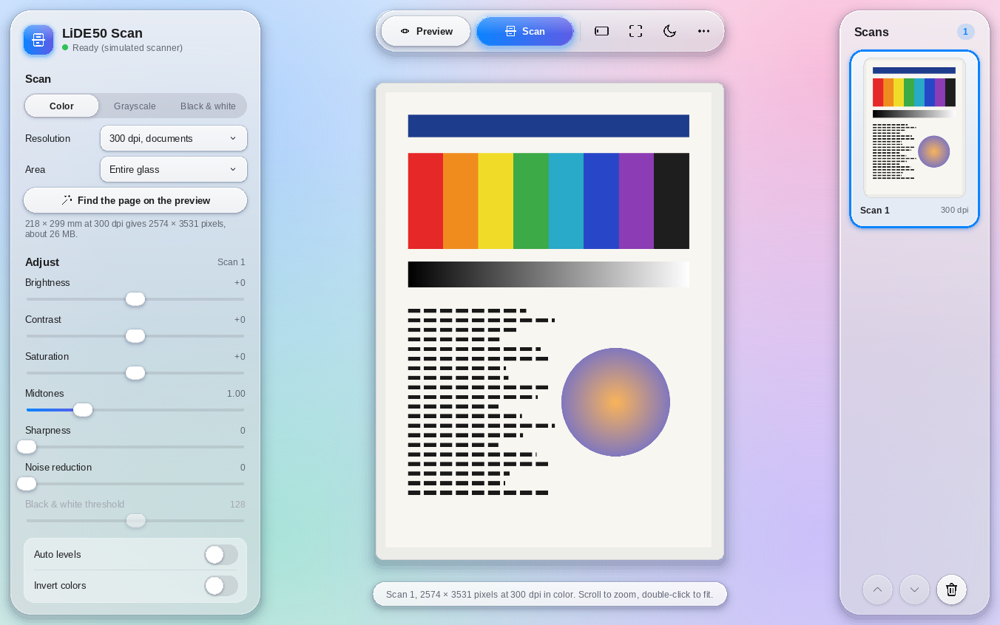
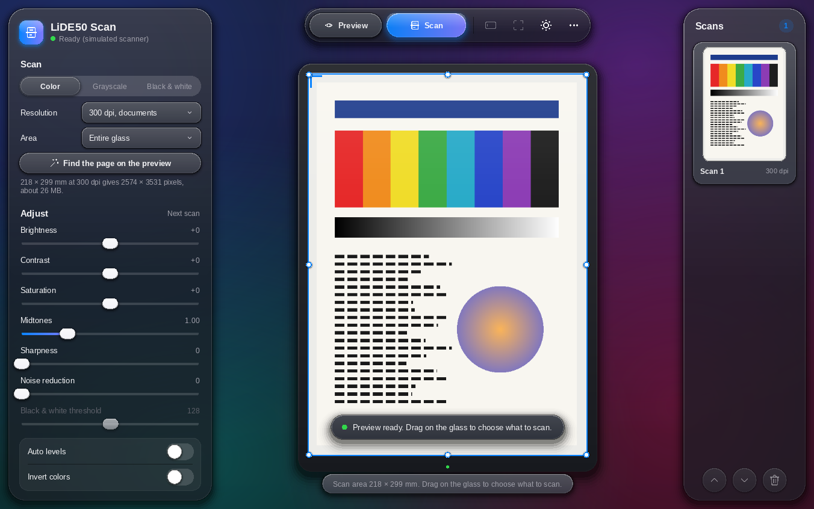

# LiDE50 Scan

A portable scanning app for the **Canon CanoScan LiDE 50** on 64-bit Windows 10 and 11.
The scanner driver is built into the program, so there is no driver package to install:
download, unzip, run.

| Light | Dark |
|---|---|
|  |  |

## Why this exists

Canon's last driver for the LiDE 50 (`lide50vst7133a`) is a 32-bit Windows XP/Vista
driver. 64-bit Windows can't load it, and Canon no longer updates it. LiDE50 Scan works
the way VueScan does: it talks to the scanner's Genesys GL841 chip directly over USB. It
uses the open-source LiDE 50 support from the [SANE](http://www.sane-project.org/)
project, reduced to this one scanner.

On first use, the app asks Windows once for permission and assigns Windows' own built-in
**WinUSB** driver to the scanner. No third-party driver is installed.

## Features

- Preview of the whole glass, then drag on it to choose what to scan. There are also
  page and photo size presets, plus automatic page detection.
- Color, grayscale and black & white, at 75 to 2400 dpi.
- The scan appears live, line by line, as it comes in.
- Adjustments update live and can still be changed after scanning: brightness,
  contrast, saturation, midtones, sharpness, noise reduction, black & white threshold,
  auto levels, invert, rotate and mirror.
- Multiple scans in one session, which you can reorder.
- Saves as **PDF, Word (.docx), PNG, JPEG, TIFF and BMP**, with multi-page PDF, Word
  and TIFF.
- The scanner's own buttons start a scan.
- A glass-style interface with light and dark mode.
- Fully portable: settings and calibration are stored next to the exe.
- An activity log (`LiDE50Scan.log`) next to the exe, with crash reports.
  Run `LiDE50Scan.exe --log` for a full USB trace.

The full user guide is in [README.txt](README.txt).

## Download

Get `LiDE50Scan-<version>-portable-win64.zip` from the
[Releases](../../releases) page. Unzip it and run `LiDE50Scan.exe`.

## Building

LiDE50 Scan is cross-compiled from Linux with MinGW-w64. On Ubuntu 24.04:

```sh
sudo apt install g++-mingw-w64-x86-64-posix gcc-mingw-w64-x86-64-posix autoconf automake libtool

# static libusb (source included)
cd third_party/libusb-1.0.27
./bootstrap.sh
./configure --host=x86_64-w64-mingw32 --enable-static --disable-shared --prefix=$PWD/../../deps
make && make install
cd ../..

make core app        # produces dist/LiDE50Scan.exe
```

The result is a single statically linked exe. It depends only on DLLs that ship with
Windows. See [BUILDING.txt](BUILDING.txt) for the source layout.

### Testing without a scanner

- `LiDE50Scan.exe --simulate` runs the whole app against a virtual LiDE 50 that scans
  a test page.
- `LiDE50Scan.exe --fake-usb` runs the real-hardware driver code against a built-in
  fake GL841 chip.

## Project layout

| Path | Contents |
|---|---|
| `app/` | Windows app: user interface (Direct2D), scanner engine, image adjustments, file writers, WinUSB setup, logging |
| `app/ui/` | Drawing layer and glass widget toolkit |
| `core/genesys/` | SANE 1.2.1 genesys backend, reduced to the GL841 / Canon LiDE 50 |
| `core/shim/` | Windows replacements for SANE's USB, configuration and debug helpers (libusb/WinUSB) |
| `third_party/` | libusb 1.0.27, miniz, stb_image_write |

## License

LiDE50 Scan is free software under the **GNU General Public License v2 or later**
(see [COPYING](COPYING)), because it contains code from the SANE genesys backend.

Included third-party code:

- SANE genesys backend: GPL-2.0-or-later
- libusb 1.0.27: LGPL-2.1-or-later
- miniz: MIT
- stb_image_write: public domain / MIT

Canon and CanoScan are trademarks of Canon Inc. This project is not affiliated with or
endorsed by Canon.
