# LiDE50 Scan troubleshooting guide

Find what you're seeing below. Every message in LiDE50 Scan shows a small **code** at the bottom (for
example `CAL-NO-LIGHT`); search this page for it to jump to the right section. This guide is also in the
app: **⋯ → Troubleshooting guide**.

**Contents**

1. [Windows stops the app the first time](#windows-stops-the-app-the-first-time)
2. [The scanner isn't found](#the-scanner-isnt-found)
3. [Needs permission: the one-time setup](#needs-permission-the-one-time-setup)
4. [Another driver is using the scanner](#another-driver-is-using-the-scanner)
5. [Windows reports a problem with the scanner](#windows-reports-a-problem-with-the-scanner)
6. [The scanner couldn't see its light](#the-scanner-couldnt-see-its-light)
7. [Too much light reached the sensor](#too-much-light-reached-the-sensor)
8. [Colours look wrong, green or tinted](#colours-look-wrong-green-or-tinted)
9. [Stretched scans or a grinding noise](#stretched-scans-or-a-grinding-noise)
10. [The connection was lost during a scan](#the-connection-was-lost-during-a-scan)
11. [Saving](#saving)
12. [The app closed unexpectedly](#the-app-closed-unexpectedly)
13. [Getting help](#getting-help)

> **Quick checks that solve most problems:** plug the scanner straight into the computer (not a hub),
> close the lid, and unplug the scanner for five seconds and plug it back in. LiDE50 Scan reconnects by
> itself.

---

## Windows stops the app the first time

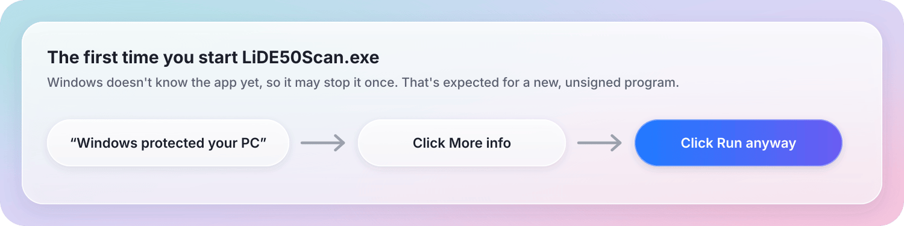

LiDE50 Scan isn't code-signed, so Windows SmartScreen may show *"Windows protected your PC"* the first
time you open it. Click **More info**, then **Run anyway**. Windows remembers the choice.

Extract the whole zip before you start `LiDE50Scan.exe`. Run from inside the zip, the app may start
but can't keep its settings or set up the scanner.

---

## The scanner isn't found

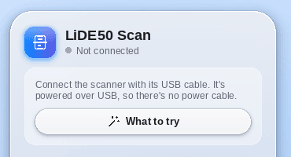

The sidebar says **Not connected** (code `USB-NOT-FOUND`) when Windows doesn't see a LiDE 50 on any
USB port.

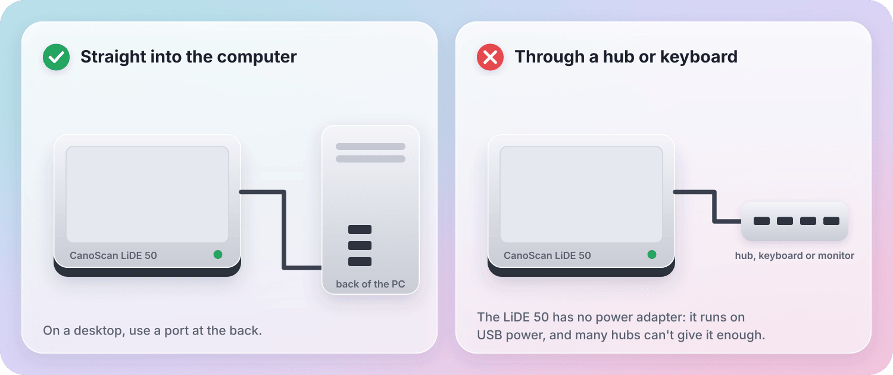

1. Plug the scanner straight into a USB port on the computer. On a desktop, use one at the back.
2. The LiDE 50 has no power adapter: it runs on USB power. Hubs, keyboards and monitors often can't
   give it enough, so avoid them.
3. Wait a few seconds after plugging in. Windows plays its device sound when it notices the scanner.
4. If nothing happens, try another USB cable and another port.
5. On a laptop, plug in the charger. Some laptops cut USB power on battery.

`USB-OPEN-IO` (*"The scanner didn't answer"*) and `USB-OPEN` mean the same checks apply: unplug the
scanner, wait five seconds, plug it back in.

---

## Needs permission: the one-time setup

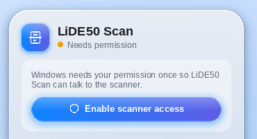

The first time, Windows has no driver for the scanner. Click **Enable scanner access** and choose
**Yes** in the Windows prompt. This assigns Windows' own built-in WinUSB driver to the scanner; nothing
is downloaded or installed. You only do this once per computer.

If the setup doesn't work:

- `SETUP-CANCELLED`: the Windows prompt was closed. Click **Enable scanner access** again and choose
  **Yes**. Without administrator rights, ask someone who has them.
- `SETUP-FAILED`: unplug and replug the scanner and try once more. If it still fails, use
  **⋯ → Manual setup steps**: in Device Manager, right-click the unknown *CanoScan* device, choose
  *Update driver → Browse my computer → Let me pick*, then *Universal Serial Bus devices → WinUsb
  Device*.
- `SETUP-TIMEOUT`: wait another minute, then unplug and replug the scanner. Restart the computer if
  it still isn't ready.
- `SETUP-NOT-STARTED`: make sure `LiDE50Scan.exe` isn't inside the zip file.

---

## Another driver is using the scanner

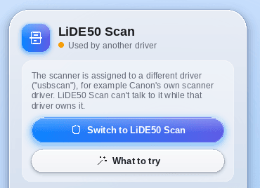

If Canon's own driver (or another scanning program's driver) was installed for the LiDE 50, it owns the
scanner (code `USB-OTHER-DRIVER`). Click **Switch to LiDE50 Scan** and approve the Windows prompt.

Canon's software won't see the scanner after the switch. To go back, use **⋯ → Remove scanner access**,
then unplug and replug the scanner.

`USB-IN-USE` means another program has the scanner open right now. Close other scanning programs
(another copy of LiDE50 Scan, VueScan, Windows Scan, NAPS2 or Canon software), then click **Try again**.

---

## Windows reports a problem with the scanner

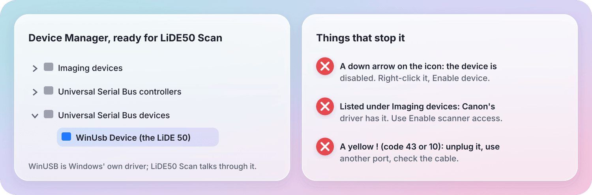

When the sidebar says **Windows reports a problem**, the message has an **Open Device Manager** button.

- `USB-DISABLED`: the device has a small down arrow. Right-click it and choose **Enable device**.
- `USB-DEVICE-ERROR` with code 43 or 10: Windows stopped the device after a USB error. This is almost
  always power or a loose cable: unplug it, use another port (not a hub), and try another cable.
  Restart the computer if the error stays; Windows sometimes keeps a port in an error state until then.

---

## The scanner couldn't see its light

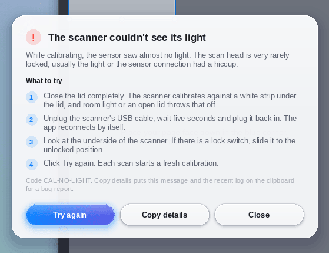

Before every scan the scanner measures its own light on a white strip under the lid. Code
`CAL-NO-LIGHT` means the sensor saw almost no light while doing that.

1. Close the lid completely.
2. Unplug the scanner, wait five seconds and plug it back in.
3. Look at the underside of the scanner. If it has a lock switch, slide it to the unlocked position.
4. Click **Try again**. Each scan starts a fresh calibration.

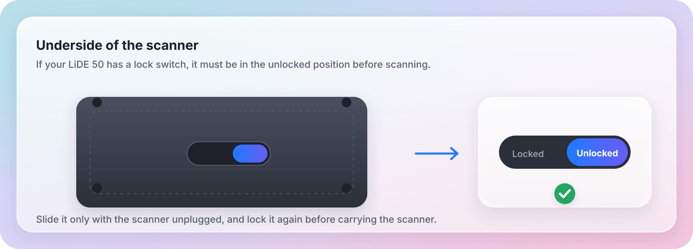

If the message names one colour (*"almost no red light"*) and the other colours were fine, the head
isn't locked: that one LED didn't light. If it happens every time, that LED in the scan head may have
failed. Scanning in **Grayscale** may still work.

---

## Too much light reached the sensor

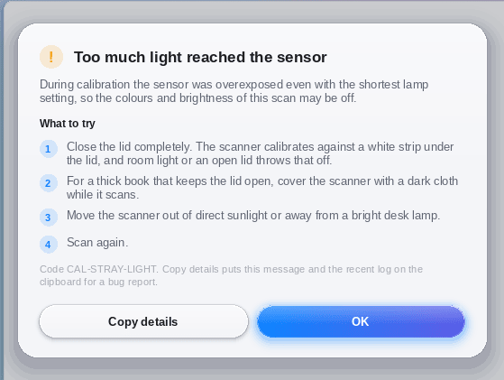

Code `CAL-STRAY-LIGHT` means light from outside the scanner got in while it calibrated, usually through
an open lid or around a thick book. `COVER-OPEN` means the scanner itself reported the lid as open.

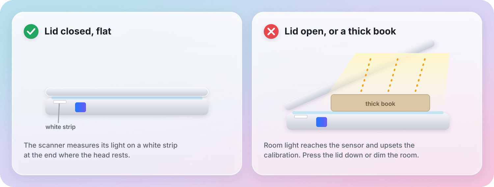

1. Close the lid and press it down gently.
2. For a thick book, scan in a dimmer room, or cover the scanner with a dark cloth.
3. Scan again. Calibration starts fresh for every scan.

---

## Colours look wrong, green or tinted

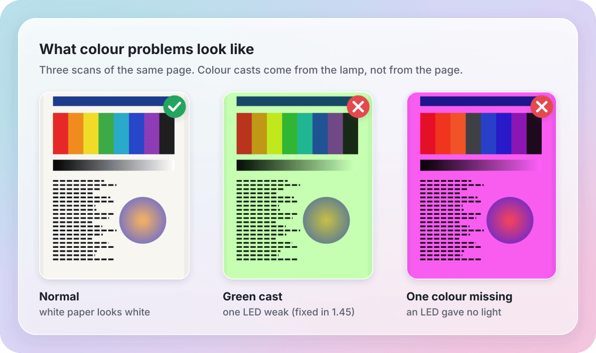

The LiDE 50 lights the page with a red, a green and a blue LED and calibrates all three before every
scan. When one of them is weaker than the others, or room light gets in, the colours come out wrong.

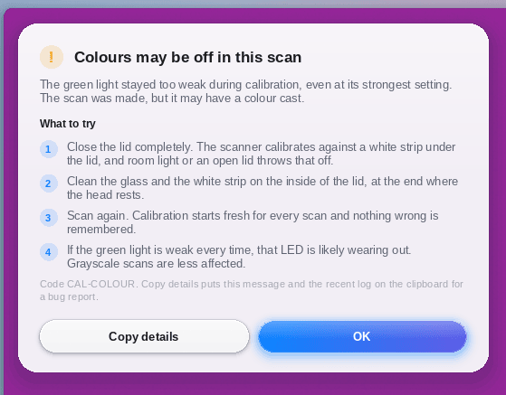

LiDE50 Scan checks every calibration and warns you (code `CAL-COLOUR`) when a colour didn't reach its
target. `SCAN-ONE-COLOUR` means a finished scan is almost entirely one colour.

1. Close the lid completely.
2. Clean the glass and the white strip on the inside of the lid, at the end where the scan head rests.
3. Scan again.
4. If the same colour is weak every time, that LED is wearing out. Grayscale scans are less affected.

Version 1.45 and later compensate for a moderately weak LED automatically. Up to version 1.4, a weak
green LED could give a strong green cast at most resolutions; update if you still use an older version.

---

## Stretched scans or a grinding noise

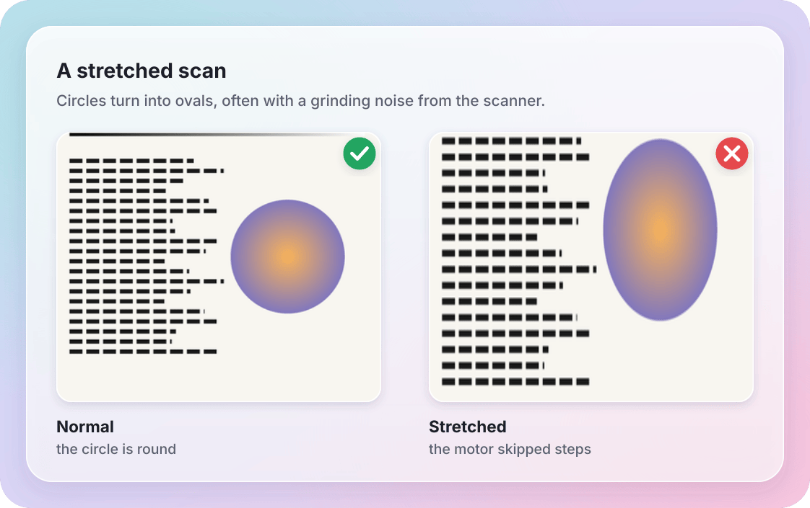

A rough or grinding noise during a scan means the motor is slipping. The image then comes out stretched
or wavy from top to bottom (code `HELP-MOTOR` in **⋯ → Help: noise or stretched scans**). At 75 to
200 dpi, and in previews, the motor runs at full speed, where an older mechanism slips most easily.

1. Put the scanner on a flat, firm surface and don't press on the lid while it scans.
2. Plug it straight into the computer, not a hub: a weak USB supply makes the motor slip too.
3. Try 300 dpi or higher. The motor runs more slowly and smoothly there, and you can reduce the size
   when saving.
4. If it happens at every resolution, report it with the resolution you used (see
   [Getting help](#getting-help)).

---

## The connection was lost during a scan

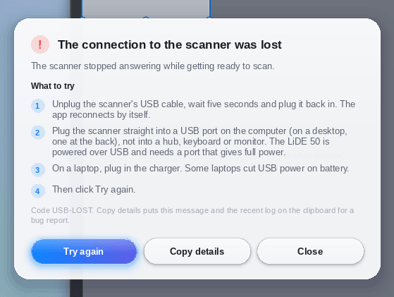

`USB-LOST`, `SCAN-INTERRUPTED` and `SCAN-NO-DATA` mean the scanner stopped answering over USB. If part
of the scan had already arrived, LiDE50 Scan keeps it in the Scans list, and it reconnects by itself as
soon as the scanner is back.

1. Unplug the scanner, wait five seconds and plug it back in.
2. Plug it straight into the computer (on a desktop, at the back), not into a hub, keyboard or monitor.
3. On a laptop, plug in the charger.
4. Click **Try again**.

`NO-MEMORY` means the computer ran out of memory for a very large scan. Select a smaller area on the
preview or choose a lower resolution: 300 dpi is enough for documents and 600 dpi for photos.

---

## Saving

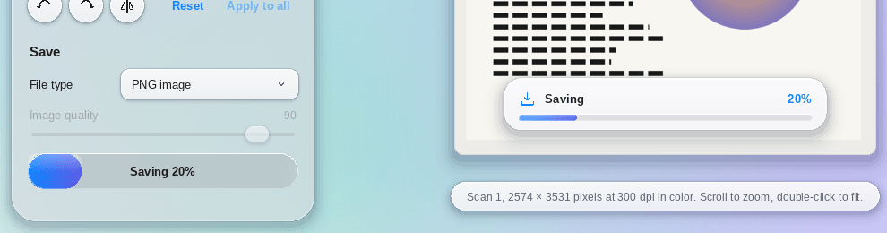

While a file is being saved, the Save section and a bar over the scan show how far it is. Large scans
at high resolutions, PNG and TIFF files, and noise reduction or sharpening take longest. You can keep
working meanwhile.

If saving fails, the message says why:

- `SAVE-DENIED`: Windows didn't allow writing there. Windows Security's ransomware protection
  (*Controlled folder access*) blocks unknown apps from Documents, Pictures and the Desktop. Save to
  another folder, such as a new `C:\Scans`, or allow `LiDE50Scan.exe` in Windows Security. The message
  has a button that opens the right page.
- `SAVE-IN-USE`: the file is open in another program (Word, a PDF viewer, a photo viewer). Close it
  there, or save under another name.
- `SAVE-DISK-FULL`: save to another drive or free up space. JPEG and PDF files are much smaller than
  TIFF, PNG or BMP.
- `SAVE-FOLDER-GONE`: the drive or network share was disconnected.
- `SAVE-NAME`: the name or path is too long or contains characters Windows doesn't allow.
- `SAVE-NO-MEMORY`: save the scans one at a time, or choose JPEG or PDF.

A failed save never damages an existing file with the same name.

---

## The app closed unexpectedly

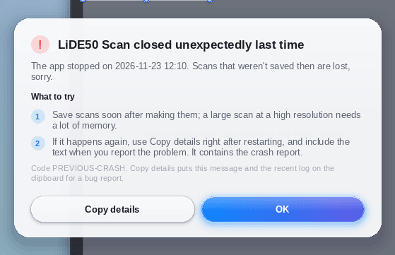

If LiDE50 Scan ever closes by itself, it writes what happened to its log, and tells you the next time it
starts (code `PREVIOUS-CRASH`). Scans that weren't saved then are lost.

1. Save scans soon after making them. A large scan at a high resolution needs a lot of memory.
2. Click **Copy details** right after restarting and include the text when you report the problem. It
   contains the crash report.

---

## Getting help

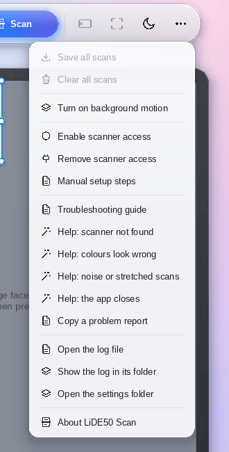

The **⋯** menu (top right) has this guide, short help topics, **Copy a problem report** and the log.

Every message also has a **Copy details** button. It puts the message, the app and Windows versions and
the end of the log on the clipboard, ready to paste. Your Windows user folder is replaced by
`%USERPROFILE%` in that text, so your user name isn't included.

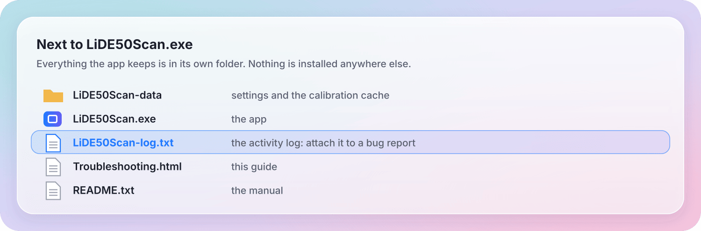

The log is `LiDE50Scan-log.txt`, next to `LiDE50Scan.exe` (up to version 1.45 it was called
`LiDE50Scan.log`). For a hard-to-catch scanner problem, start the app with `LiDE50Scan.exe --log` and
repeat what you did: that also records every USB transfer.

To report a problem, open an issue at
[github.com/ifloofie/LiDE50-scanner/issues](https://github.com/ifloofie/LiDE50-scanner/issues) and paste
the **Copy details** text. Say which resolution and colour mode you used, and whether the lid was open.
